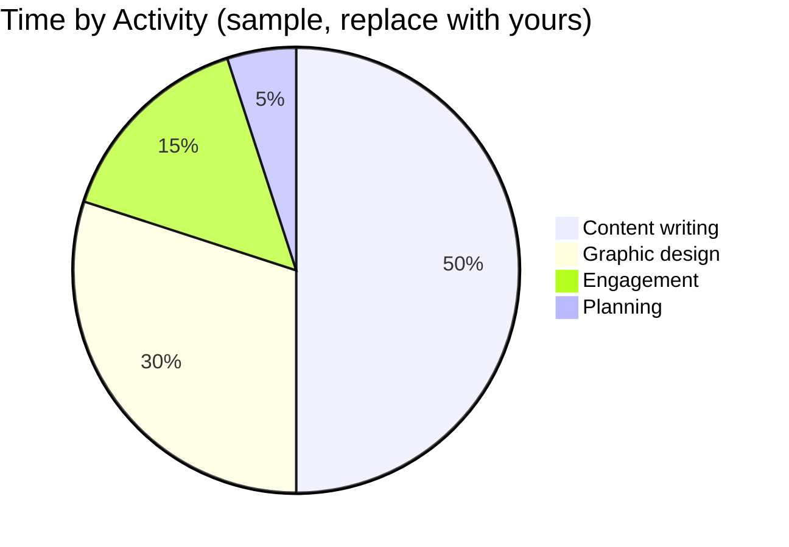
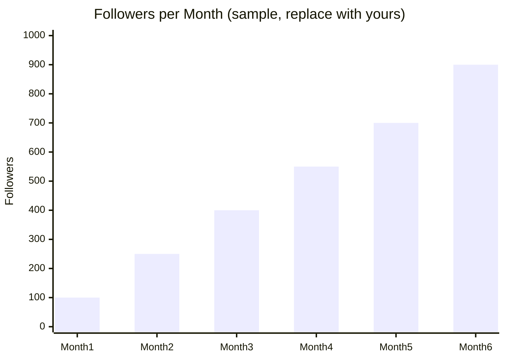

<div align="center">


</div>

> Replace every `[bracketed]` item and every sample number with your real data before you publish. Delete anything you can't back up.

---

## About This Internship

I worked as a **Social Media Management Intern at Galactic 3D Pvt. Ltd.**, managing the company's social media presence and designing its visual content. This repository collects my work and what I learned.

| | |
|---|---|
| 🎯 **Role** | Social Media Management Intern |
| 🏢 **Company** | Galactic 3D Pvt. Ltd. |
| 📅 **Duration** | [Month Year] to [Month Year] |
| 📍 **Location** | [Bangalore / Remote] |
| 🛠️ **Tools** | Figma, [add any scheduling or analytics tools] |

## 🚀 What I Did

- 📣 **Managed the company's social media** on LinkedIn, Instagram and X, keeping the pages active and consistent.
- ✍️ **Wrote industry-focused content** and adapted it to suit each platform.
- 🎨 **Designed graphics and promotional material in Figma** to keep the visual branding consistent.
- 💬 **Worked on audience engagement** by [describe what you did, for example posting schedule or replying to comments].

## 📊 Where My Time Went

Sample figures. Replace them with your own estimate.

```
Content writing      ██████████░░░░░░░░░░  50%
Graphic design       ██████░░░░░░░░░░░░░░  30%
Engagement           ███░░░░░░░░░░░░░░░░░  15%
Planning             █░░░░░░░░░░░░░░░░░░░   5%
```



## 📈 Results

Only use numbers you can verify from the platform analytics. The values below are sample values.



- ✅ [Followers grew from X to Y]
- ✅ [Average post reach increased by X%]
- ✅ [Most engaging post: topic, format and result]

## 🖼️ Selected Work

Screenshots show your skills better than descriptions. Add your images to an `images/` folder and uncomment the lines.

### Social Media Posts
<!--  -->
- **[Post title]:** [Goal and what you made]

### Graphic Design (Figma)
<!--  -->
- **[Design name]:** [What it was for and your design choices]

### Promotional Material
- **[Campaign name]:** [What it promoted and who it targeted]

## 🧠 What I Learned

- Writing for different platforms and audiences
- Keeping a consistent visual brand across posts and designs
- Designing quickly in Figma to meet posting deadlines
- Explaining technical and industry topics in a simple, engaging way

## 🗂️ Repository Structure

```
.
├── README.md
├── images/          # Screenshots of posts and graphics
├── designs/         # Exported Figma designs
└── content/         # Sample post copy and content calendar
```

## 📬 Contact

<div align="center">

**Yashaswini R**

[](mailto:yashaswiniy502@gmail.com)
[](https://www.linkedin.com/in/yashaswini-r-400946306)
[](https://github.com/Yashaswini-77)

*Shared with permission. Brand assets belong to Galactic 3D Pvt. Ltd.*


</div>
